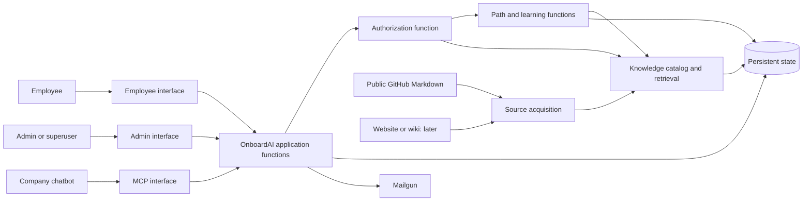

# System overview

**Status: Proposed for team review.** This is a map of logical responsibilities and flows. It does not choose a DBMS, search product, AI provider, or deployment topology. A box in the diagram does not imply a separate service.

## Inputs

- [Statement of work](../statement-of-work.md): milestone journeys.
- Accepted rules: [AR-SYS-001–004](../adr/01-system-boundaries.md) and [AR-DATA-001–005, AR-DATA-007](../adr/02-data-and-knowledge.md).
- Identity, learning, and interface rules are [drafts](../adr/README.md). AR-DATA-006 is deferred.

## Proposed logical components and boundaries

| Component or external system | Responsibility | Inputs and outputs | Trace | Status |
| --- | --- | --- | --- | --- |
| Employee interface | Present team information, topics, paths, progress, sources, and notices. | Employee actions in; permitted results out. | AR-SYS-001–002; SR-INT-001, SR-INT-010–012 | Proposed |
| Admin interface | Present team, invitation, appointment, and assignment actions. | Admin actions in; confirmations or denials out. | AR-SYS-001–002; SR-INT-002, SR-INT-008–009 | Proposed |
| MCP interface | Serve signed-in company-chatbot knowledge requests under its first-iteration policy. | Identity and request in; source-backed result or denial out. | AR-SYS-001–002; SR-INT-003 | Proposed; registration details open |
| Identity, team, and invitation functions | Authenticate accounts and manage teams, admins, invitations, and transfers. | Identity and invitation actions in; account/team state out. | AR-SYS-002; SR-FUNC-010, SR-FUNC-013–017 | Proposed |
| Authorization function | Decide allowed actions and permitted knowledge for ordinary onboarding, assignments, and MCP. | Actor and request context in; permitted scope or denial out. | AR-SYS-001–002; SR-SEC-001–004, SR-SEC-011–014 | Proposed; check points open |
| Source acquisition functions | Read public GitHub Markdown first, later a website or wiki; detect updates and failure. | Source content and metadata in; source records or failure out. | AR-SYS-003–004; AR-DATA-001–003 | Proposed |
| Knowledge catalog and retrieval | Maintain retrievable knowledge with source identity, team/shared classification, timestamps, and citations. | Source records and scoped queries in; evidence out. | AR-DATA-001–003; SR-DATA-005–008 | Proposed; storage choice open |
| Path and learning functions | Derive topics, create paths, manage active progress and updates, record completion. | Topic/assignment and permitted evidence in; path state out. | AR-DATA-004–005; SR-FUNC-023–032 | Proposed; generation method open |
| Persistent state | Preserve accounts, teams, invitations, assignments, active progress, and user-to-completed-path records. | State queries and changes in; durable records out. | AR-DATA-004–005, AR-DATA-007 | Proposed; data model and DBMS open |
| External systems | GitHub, later website/wiki, Mailgun, optional AI provider, company chatbot. | Documents, email delivery, optional generation, chatbot interaction. | AR-SYS-003–004; SR-DATA-002, SR-INT-003, SR-INT-006 | Integrations to detail |

The employee and admin interfaces may share a frontend implementation, and MCP may share backend code. The distinct access boundaries required by AR-SYS-001 must remain identifiable.

## Conceptual information flow

The diagram does not decide whether the catalog and durable records use one DBMS. Protected knowledge requests must carry the identity, team, and assignment context required by AR-SYS-002. Path functions must retrieve knowledge within that permitted scope. Exact policy-check points belong in [identity and access design](04-identity-and-access.md).

## End-to-end flows for team review

| Flow / milestone | Route | Access decision and result | Remaining design work |
| --- | --- | --- | --- |
| Team creation and invitation / 1 | Admin interface → identity/team/invitation functions → Mailgun → acceptance → persistent state | Inviter's authority is checked; accepted invite sets the recipient's team. | Delivery, expiration, reuse, and transfer handling. |
| Basic team onboarding / 1 | Sign-in → employee interface → authorization → team/shared knowledge → basic path | Employee sees permitted team and shared material. | Basic path construction; dynamic topics start in milestone 2. |
| Dynamic topic path / 2 | Employee interface → authorization → derived topics → retrieval → path/progress state | Database and API topics yield distinct source-backed paths; active progress survives sign-in. | Topic and path-generation methods. |
| Source refresh / 2 and 5 | GitHub or wiki → source acquisition → knowledge representation → affected active paths | Completed changed steps trigger revisit; future steps update quietly. | Change detection; failure preserves active path with freshness warning under AR-SYS-004. |
| Chatbot retrieval / 6 | Chatbot → MCP interface → authorization → retrieval → chatbot | Signed-in users can retrieve all scraped documents in the first iteration; OnboardAI retains no chatbot conversation. | Registration, identity propagation, external chatbot retention. |
| Individual assignment / 7 | Admin interface → assignment → employee interface → authorization → path functions | Team admin assigns within own team; explicit assignment can grant the employee path-scoped cross-team knowledge. | Grant representation and enforcement points. |
| Completion and later caution / 2 and 7 | Path functions → retained user/path completion record; later source refresh → caution | Generated path content and steps are deleted. | How to identify affected employees is deferred under AR-DATA-006. |

## Decisions the team needs to make

| Decision | Evidence to gather | Where to record the answer |
| --- | --- | --- |
| Which logical responsibilities should be combined in the implementation? | Walk the milestone-1 and MCP flows; compare implementation effort and clarity of boundaries. | This file; [technology choices](08-technology-choices.md) |
| Where are authorization decisions made and rechecked? | Trace allowed and denied onboarding, assigned-path, and MCP requests. | [Identity and access](04-identity-and-access.md) |
| Which data is authoritative, disposable, indexed, and retained after completion? | List entities, read/write patterns, consistency, deletion, and recovery needs before DBMS research. | [Data and database](02-data-and-database.md) |
| What common representation connects source types to retrieval and citations? | Inspect representative documents and test source identity and updates. | [Knowledge retrieval and AI](03-knowledge-retrieval-and-ai.md) |
| How can later source changes identify affected completers? | Compare user/path-only records with any proposed additional metadata; revisit AR-DATA-006. | Deferred AR-DATA-006, then data design |

## Decision record

**Chosen high-level map:** Open — team review required.

**Alternatives and rationale:** Record when the team compares component groupings and deployment approaches.

**Verification:** Trace the flows against accepted rules and test boundaries with representative users and documents.
