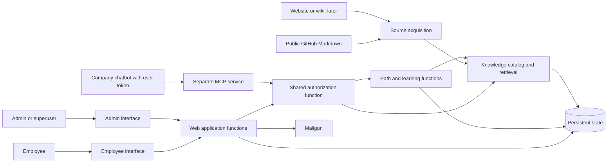

# System overview

**Status: Proposed for team review, with selected technology and deployment boundaries.** The team chose PostgreSQL with pgvector and a separate MCP service reached by the company chatbot using per-user tokens. Other boxes remain logical responsibilities; AI provider and hosting platform remain open.

## Inputs

- [Statement of work](../statement-of-work.md): milestone journeys.
- Accepted rules include [AR-SYS-001–004](../adr/01-system-boundaries.md), [AR-DATA-001–007](../adr/02-data-and-knowledge.md), [AR-ACCESS-005 and AR-ACCESS-009–010](../adr/03-identity-and-access.md), and [AR-LEARN-008–010](../adr/04-answers-and-onboarding.md). Other rules remain drafts.

## Proposed logical components and boundaries

| Component or external system | Responsibility | Inputs and outputs | Trace | Status |
| --- | --- | --- | --- | --- |
| Employee interface | Present available team paths, assigned Projects, progress, source links, and notices. | Employee actions in; assigned results out. | AR-SYS-001–002; SR-INT-001, SR-INT-010–013 | Proposed |
| Admin interface | Present team, invitation, appointment, path and Project generation/review, audience, and assignment actions. | Admin actions in; confirmations or denials out. | AR-SYS-001–002; SR-INT-002, SR-INT-008–009 | Proposed |
| MCP service | Separate entry point for company-chatbot knowledge requests; verify each user's token before retrieval under the first-iteration chatbot policy. | Per-user token and request in; source-backed result or denial out. | AR-SYS-001–002; SR-INT-003 | Team-chosen boundary and token approach; registration details open |
| Identity, team, and invitation functions | Authenticate accounts and manage teams, admins, invitations, and transfers. | Identity and invitation actions in; account/team state out. | AR-SYS-002; SR-FUNC-010, SR-FUNC-013–017 | Proposed |
| Authorization function | Decide allowed actions and permitted knowledge for ordinary onboarding, assignments, and MCP. | Actor and request context in; permitted scope or denial out. | AR-SYS-001–002; SR-SEC-001–004, SR-SEC-011–014 | Proposed; check points open |
| Source acquisition functions | Read public GitHub Markdown first, later a website or wiki; detect updates and failure. | Source content and metadata in; source records or failure out. | AR-SYS-003–004; AR-DATA-001–003 | Proposed |
| Knowledge catalog and retrieval | Maintain a common indexed document pool with source identity, timestamps, and citations. A document may support paths for multiple teams. | Source records and search context in; evidence out. | AR-DATA-001–003; SR-DATA-005–008 | PostgreSQL with pgvector chosen; indexing detail open |
| Path and learning functions | Generate shared team paths and Projects from admin keywords, manage review and publication, employee progress, updates, and completion. | Admin keyword, relevant evidence, and assignments in; reusable path state out. | AR-DATA-004–006; SR-FUNC-023–033 | Proposed; generation method open |
| Persistent state | Preserve accounts, teams, invitations, shared paths and Projects, assignments, active progress, and user-to-completed-path records. | State queries and changes in; durable records out. | AR-DATA-004–007 | PostgreSQL chosen; schema open |
| External systems | GitHub, later website/wiki, Mailgun, optional AI provider, company chatbot. | Documents, email delivery, optional generation, chatbot interaction. | AR-SYS-003–004; SR-DATA-002, SR-INT-003, SR-INT-006 | Integrations to detail |

The employee and admin interfaces may share a frontend implementation. MCP runs as a separate service, but may share retrieval and authorization code with the web application through a common library or internal component. The distinct access boundaries required by AR-SYS-001 remain identifiable.

## Conceptual information flow

The MCP request does not pass through the web application's authentication endpoint. The authorization box represents shared policy behavior; its implementation and call mechanism remain open. PostgreSQL with pgvector is the chosen prototype store for records and vectors. Protected requests must carry the identity, team, and assignment context required by AR-SYS-002. A team path's owner and audience control which employees see it; those attributes do not make its supporting documents exclusive to the team. Exact policy-check points belong in [identity and access design](04-identity-and-access.md).

## End-to-end flows for team review

| Flow / milestone | Route | Access decision and result | Remaining design work |
| --- | --- | --- | --- |
| Team creation and invitation / 1 | Admin interface → identity/team/invitation functions → Mailgun → acceptance → persistent state | Inviter's authority is checked; accepted invite sets the recipient's team. | Delivery, expiration, reuse, and transfer handling. |
| Basic team onboarding / 1 | Sign-in → employee interface → authorization → basic saved team path | Employee sees a path available through team membership and path audience. | Basic path construction; keyword generation starts in milestone 2. |
| Admin-generated team paths / 2 | Admin interface → keyword → common-pool retrieval → saved draft → admin review and publication → employee progress | Database and API keywords yield distinct reusable Software paths; assigned employees keep independent progress. | Generation and review methods. |
| Source refresh / 2 and 5 | GitHub or wiki → source acquisition → knowledge representation → affected active paths | Completed changed steps trigger revisit; future steps update quietly. | Change detection; failure preserves active path with freshness warning under AR-SYS-004. |
| Chatbot retrieval / 6 | Chatbot with per-user token → separate MCP service → token verification → authorization → retrieval → chatbot | A verified signed-in user can retrieve all scraped documents in the first iteration; OnboardAI retains no chatbot conversation. Missing or invalid user tokens are denied. | Verify that the selected chatbot supports this connection and determine token issuer, verification, and external chatbot retention. |
| Project generation and assignment / 7 | Admin keyword → common-pool retrieval → saved shared Project → assigning admin reviews for each employee → visible assignment → employee interface | Team admin assigns to employees on administered teams; the same Project and source links can serve multiple employees with separate progress. | Assignment contracts. |
| Completion and later caution / 2 and 7 | Employee progress → retained user/path completion record; later relevant source refresh → general warning | Shared path or Project and steps remain; only the completing employee's step progress is deleted. | Preserve enough path-to-source provenance to identify affected completers. |

## Decisions the team needs to make

| Decision | Evidence to gather | Where to record the answer |
| --- | --- | --- |
| Which remaining logical responsibilities should be combined in the implementation? | Walk the milestone-1 flows and the chosen separate MCP boundary; compare implementation effort and clarity of boundaries. | This file; [technology choices](08-technology-choices.md) |
| Where are authorization decisions made and rechecked? | Trace allowed and denied onboarding, assigned-path, and MCP requests. | [Identity and access](04-identity-and-access.md) |
| Which data is authoritative, disposable, indexed, and retained after completion? | List entities, read/write patterns, consistency, deletion, and recovery needs before final schema design. | [Data and database](02-data-and-database.md) |
| What common representation connects source types to retrieval and citations? | Inspect representative documents and test source identity and updates. | [Knowledge retrieval and AI](03-knowledge-retrieval-and-ai.md) |
| How can later source changes identify affected completers? | Trace saved path/Project-to-source provenance to retained user/path completion records; exact representation remains open. | AR-DATA-006; data design |

## Decision record

**Chosen high-level map:** MCP is a separate service reached by the company chatbot with a per-user token. Other component groupings remain open for team review.

**Alternatives and rationale:** Record when the team compares component groupings and deployment approaches.

**Verification:** Trace the flows against accepted rules and test boundaries with representative users and documents.
