# Knowledge, retrieval, and AI design

## Questions

- How does approved content enter, update, and leave the system?
- How are provenance, versions, source location, and permissions preserved through transformations?
- How is eligible material searched, filtered, ranked, and passed to an answer generator?
- Would exact-term matching improve retrieval of acronyms, API names, paths, and code symbols? Compare BGE-M3 vector search alone with PostgreSQL full-text ranking and a BM25-based hybrid option.
- How are answers grounded and cited, and when does the system abstain?
- How are stale, conflicting, malformed, or malicious sources handled?
- What data is sent to external AI services, if any?

## Source and answer flows

| Step | Input | Processing and policy | Output | Failure or uncertainty behavior | Requirement / rule |
| --- | --- | --- | --- | --- | --- |
| Team-path generation search | Signed-in admin of the destination team, keyword | Search the common indexed pool for evidence relevant to the requested path; preserve original-source links. Path ownership does not make a source exclusive to that team. | Evidence for a reusable team-path draft | Show insufficient evidence or generation failure without publishing an incomplete path | AR-LEARN-001, AR-LEARN-006 |
| Project generation search | Signed-in admin, keyword | Search the full indexed document pool for material relevant to the keyword. The Project and its sources are not assigned to a team. | Evidence for a reusable Project draft, with source references | Show insufficient evidence or generation failure without saving an incomplete Project | AR-LEARN-008; AR-ACCESS-009 |
| Company-chatbot MCP search | Signed-in employee or admin with verified per-user token, knowledge request | Apply the first-iteration chatbot policy: search all scraped documents regardless of team | Source-backed knowledge and citations | Deny invalid identity; return unavailable result on retrieval failure | AR-ACCESS-004; AR-OPS-004 |

## Chosen approach and rationale

**Team design:** PostgreSQL with pgvector is the selected vector storage and similarity-search technology. BGE-M3 through Ollama is the selected embedding model and runtime for indexed documentation sections and search requests. Qwen3-8B through Ollama is the selected starting model and runtime for generating and revising path drafts, subject to representative quality and latency tests. An admin gives the path generator a topic or keyword; it saves reusable team-owned path content and ordered steps at runtime using relevant common-pool documents. An admin reviews a new path before first publication. When changed source material affects a published path, successfully regenerated changes publish automatically without another admin review; a failed refresh leaves the current path available with a freshness warning. Previously completed changed steps require a revisit notice, while future steps update quietly. The chunking method, keyword or hybrid search, ranking, citation construction, and deployed Ollama host remain open. Employee path visibility and chatbot retrieval use their distinct authorization rules.

## Selected indexing and path-generation flow

```mermaid
flowchart LR
    source[Original documents: GitHub Markdown, later GitLab Wiki] --> ingest[Ingest text and preserve source URL, identity, and timestamp]
    ingest --> chunks[Split text into searchable sections]
    chunks --> embed[BGE-M3 via Ollama: embed each section]
    embed --> index[PostgreSQL with pgvector: store sections, vectors, and source references]
    request[Authorized admin: path keyword] --> query[BGE-M3 via Ollama: embed keyword]
    query --> search[Search pgvector for relevant sections]
    index --> search
    search --> evidence[Retrieved sections with original-source references]
    evidence --> generate[Qwen3-8B via Ollama: draft ordered path steps]
    generate --> validate[Validate step structure, evidence links, and AI-suggestion labels]
    validate --> saved[Save reusable draft team path or Project and its steps]
    saved --> teamreview[Team path: admin review before publication]
    saved --> projectreview[Project: assigning admin reviews for each employee]
```

**Boundary of each model:** BGE-M3 represents source sections and the admin's keyword as comparable vectors; it does not compose explanations or steps. Qwen3-8B receives the retrieved text and proposes the path's summaries, reading steps, and questions. Generation must preserve links back to the original sources and distinguish unsupported AI suggestions from documented statements. The same BGE-M3 model and embedding settings must be used for indexing and searching. Changing the embedding model requires re-embedding the indexed sections.

**Scope of publication:** A new team path is reviewed by its team's admin before publication. A new Project is saved independently of employees, and each assigning admin reviews it for the recipient employee before that assignment becomes visible. Source-driven revisions follow the already agreed automatic-publication and employee-notice rules. The retrieval pool remains common across teams; team-path ownership and Project assignments control employee path visibility, not source ownership.

**MCP distinction:** The first chatbot MCP tools can use the same BGE-M3 and pgvector retrieval flow to return source-backed knowledge. The customer's Claude or ChatGPT host composes its chat response; Qwen3-8B is selected for OnboardAI path generation, not as a required chatbot model.

**Open lexical-search decision:** BGE-M3 plus pgvector is the selected starting retrieval path. Evaluate whether adding lexical search improves evidence recall for representative onboarding requests, especially exact technical terms and acronyms. PostgreSQL includes `ts_rank` and `ts_rank_cd` full-text ranking, which are not BM25. A true BM25 option such as the PostgreSQL `pg_search` extension adds a deployment dependency whose availability on the chosen host must be checked. Compare vector-only, built-in full-text plus vector, and BM25 plus vector results before selecting a hybrid strategy or score-fusion method. Do not treat BM25 as selected yet. [PostgreSQL full-text ranking](https://www.postgresql.org/docs/current/textsearch-controls.html); [pg_search](https://github.com/paradedb/paradedb).

**Project generation scope:** A Project is generated from an admin's keyword against the indexed documentation pool. Generation searches the full pool without a team filter. A Project is not owned by a team. The team assumes indexed documents are not confidential and allows team admins to inspect sources during Project creation and review. A Project assignment governs which employees see the Project and can follow its linked original sources. The exact retrieval/ranking method and generator component boundary remain open.

**Project assignment review and refresh:** The admin assigning a Project reviews its shared content for that employee before the assignment becomes visible. Each assigning admin reviews the Project, even if another admin reviewed it for a different employee. A successful source-driven regeneration becomes available to existing assignees automatically without another review. Active employees receive the agreed step-change behavior; completers receive only a general warning when source material associated with their finished Project changes. The shared Project and steps remain available after any one employee completes them.

**Original-source links:** Employees must be able to open every original document linked from a team path or Project assigned to them. The searchable index can hold derived text and source references without becoming an employee-facing library of full document copies. Opening an original link depends on the source system's own access rules; the prototype's first GitHub source is public. The later website or wiki connector must provide original links that assigned employees can open; choose its sign-in mechanism when selecting the source. Path ownership does not make a supporting document exclusive to that team.

**Serious alternatives and tradeoffs:**

**Source and answer sequence diagrams:**

**Verification / open questions:**
